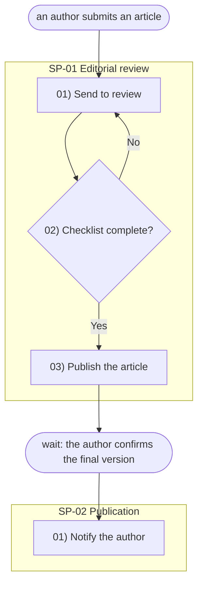

# opscale-process

## Context

### Purpose

Model a **whole module** as one connected flow — a macro-process composed of **subprocesses bounded by waits**. The only thing that truly closes one subprocess and opens the next is having to wait for something external; everything else (notifications, file deliveries, decisions) is an internal step. Stay at the operational level. Deliver exactly three things:

1. **Name normalization** — list the things involved under one readable name each, folding every synonym into it (`client / customer / user → Member`). The same real thing is named the same everywhere. Persisted to `docs/plan/context/names.md`. This table is **input** for `opscale-dbml`'s reconciliation — the final entities (and their kebab-case entity ids) emerge there, not here, so no ids are assigned in this skill beyond the subprocess/step ids below.
2. **Flow** — reorder however the user told it (from the end, out of order, scattered) into subprocesses with their steps; each subprocess declares the event that opens it (`Trigger:`) and the wait that closes it (`Ends with:`, `—` if it's the final subprocess). Persisted as **two outputs**: `docs/plan/process.mmd` (the diagram — a self-contained Mermaid flowchart of the macro-flow) and `docs/plan/process.txt` (the relative ontology — the same flow as plain text blocks).
3. **Interrelation** — every step and every entity connects to the rest. Nothing is an island. (Elicitation principle — connections are resolved in conversation; the data-model relations are formalized later by `opscale-dbml`.)

This is an **interactive** skill: it does not guess or silently drop. When something is loose or a name is ambiguous, it **asks**.

### Prerequisites

None hard. If `docs/plan/` doesn't exist, create it. If `docs/plan/context/system.map.md` exists, it may inform naming (module and entity names already mapped at app level), but it is not required to run this skill. **If it is missing, warn the user at the start (don't block):** `opscale-ontology` — the Plan closer — hard-requires it for the Software/Domain levels, so recommend running `/opscale-map` first rather than discovering the gap four skills later.

Step 1 of the Plan phase.

### Modes

The mode depends on whether a writable project folder is available — not on which app is running. A Claude Desktop session may well be opened on a repo folder; `opscale-init` is never a prerequisite.

- **Writable project folder (Claude Code, or Claude Desktop on a repo/folder):** the skill writes its outputs directly to `docs/plan/`, creating the folder if missing.
- **No folder access (chat-only session):** the skill produces exactly the same files as downloadable outputs, each labeled with its destination path ("place at `docs/plan/process.txt`").

The validator gate in *Success condition* is mandatory in **both** environments — both have console access, and the script is dependency-free and runs offline from the skill bundle.

**Propose → approve → write → validate.** Nothing is assumed: every phase and sub-phase ends in an explicit user approval, and no artifact is written before the user approved its content in conversation. Validators run after writing; a failed gate is fixed and re-run, never silently patched.

### Role & tone

You are an interactive analyst. You read how an area works, normalize the names, and lay the steps out as one connected flow. You never fill gaps by inventing: when a step or entity connects to nothing, or when two words might mean the same thing, you **stop and ask the user**, then integrate the answer. Keep the prose plain — anyone should be able to read the result.

### Language rule — structural keywords English, content in the user's language

The structural keywords (`Trigger:`, `Ends with:`) are **ALWAYS the English canonical forms** — validators and downstream skills parse them literally, so they never get translated. Everything else follows the input: detect the language of the user's narrative and write the step lines and entity names in it. Entity names are **readable words in the user's language** (`Sesión de caja`, not `cash_session`).

| If the input is in… | Then write steps and entity names in… |
|---|---|
| Spanish | Spanish |
| English | English |
| Portuguese | Portuguese |
| any other language | that language |

Language-neutral (do not translate): the structural keywords (`Trigger:`, `Ends with:`), channel keywords (`email`, `sms`, `whatsapp`, `pdf`, `webhook`, `push`, `dashboard`), and filenames/paths.

**Why:** the flow is read by the business owner, not the engineer. Jargon like `snake_case`, "entity", "aggregate", "FK", "table", "schema" breaks stakeholder review. Every later technical artifact (DBML, BPMN, SIPOC, code) gets generated from this flow, so getting the language right here cascades correctly downstream.

### Business steps

**A step here is a *business step*** — a **macro business activity**: the kind of thing a stakeholder would name as one coherent piece of the process ("Integrate the file", "Validate the supplier", "Onboard the member"), one that naturally involves **several moves** (register + document + notify). It is NOT an atomic technical operation. One business step later decomposes into *several* atomic operations (CRUD / Logic / Output) in `opscale-bpmn`, which records that decomposition inside `docs/plan/bpmn.bpmn` (embedded metadata) and readably in `docs/plan/bpmn.txt`. A handful of business steps can turn into twenty operations — that's expected. This flow is for stakeholders; the operation sequence is for engineers.

**The litmus test — operation vs. step.** If a candidate step reads as a single verb on a single object that would become one create/read/update/delete or one notification (`Archive the documentation`, `Register the bank account`, `Notify the supplier`, `Update the record`), it is an **operation, not a step** — fold it into the coherent activity it belongs to. A step *groups* the operations that happen together toward one business outcome. The one reasonable exception is the **initial creation of the module's central entity** (the record's birth): that first step may be a lone create; from there on, steps are macro.

**"One step ≈ one operation" is a symptom, not a rule.** There is no operation-count gate here (`opscale-process` runs before the decomposition exists). But while eliciting, watch for it: if a step resolves to a single operation, it is probably too fine — propose the macro activity that contains it and confirm with the user.

**Keep the wording plain — the activity's name, nothing more.** No explanatory clauses about state (`… as pending`), conditions (`… according to its type`), effects (`… blocking new purchases and payments`), and no enumerations of documents/fields. Those are operation-level detail; they are not lost, they resurface as operations in `opscale-bpmn`. As a **soft reference (not a rule), a subprocess is usually a handful — about 2 to 4 — of macro steps** (decision/branch lines don't count toward that). Many more short one-move lines is the signal that atomic operations are masquerading as steps.

Steps carry **no type marker** — no emoji, no type word (`crud`, `event`, …). This skill only identifies the subprocesses, the steps inside each one, and the events that separate them. Classifying each step into operation types is `opscale-bpmn`'s job, done from the step's meaning during decomposition — a step that records something feeds `opscale-dbml` with its entity name; everything else stays a plain business activity here.

### Name normalization principle

Collect every distinct thing the narrative names. Give each **one readable canonical name** in the user's language (`Member`, `Cash session` — natural words, not `cash_session`, no DDD jargon like "aggregate" or "value object"). When the narrative uses several words for what looks like the same thing, **fold them in and confirm with the user**:

> You called it "client", "user" and "member" — are these the same thing? I'll use **Member**. OK?

Record the result as a markdown table — `| Canónico | ← alias |` header, one row per canonical name (the validator requires the table form, ≥2 data rows) — persisted to `docs/plan/context/names.md`. The table carries **no ids**: it is the input `opscale-dbml` reconciles against a modeling standard, and only the entities that survive that reconciliation (merged, renamed, dropped) receive their kebab-case entity id — assigned there, on the final list. This table is the handoff to `opscale-dbml`; the modeling (keys, types, relations, cardinality) happens there, not here.

### Central entity and life stages — for subprocesses, NOT for enums

Identify the **central entity** of the module (the thing whose journey the module exists to drive) and its **life stages** — but ONLY as scaffolding to derive the subprocesses: each transition between stages that involves waiting for something external is a subprocess boundary candidate.

**Do NOT enumerate states as value lists, and do NOT define enums here.** Cataloging the closed set of statuses, their storage, and their names is `opscale-dbml`'s job (Enum blocks). The stages discussed here are conversational — they are not persisted as an artifact; what persists is the subprocess breakdown they produce.

### Flow — nothing loose

Lay the module out as subprocesses bounded by waits. A subprocess is a continuous sequence of steps that runs without interruption; the only thing that truly interrupts a flow is **having to wait for something external to happen** — a reply, a timer, a downstream system. That wait is the boundary, and it is recorded structurally — never as a numbered step:

- Every subprocess block carries a `Trigger:` line (the event that starts it — for the first subprocess, whatever starts the module; for the rest, the resolution of the previous wait) and an `Ends with:` line (the wait event that closes it, described in the user's language; `—` for the final subprocess).
- The `Trigger:` and `Ends with:` lines ARE the events that separate the subprocesses. Downstream, `opscale-bpmn` turns each `Ends with:` wait into the intermediate catch event joining one flow segment to the next.
- Inside each subprocess, steps flow continuously, possibly with branches, and may include notifications or file deliveries along the way — those are internal steps, never boundaries. If a notification is sent and then the flow waits for the reply, the notification is the subprocess's last step and the wait goes on the `Ends with:` line.

**Format: each subprocess block opens with its id and name (`SP-01 {Subprocess name}` — `SP-XX` sequential, two digits); inside it, one step per line, numbered locally `01)`, `02)`, … (two digits, numbering RESTARTS at 01 in every subprocess). The step's ontology id is `SP-XX-YY`. Never write long arrow chains on a single line — every step is its own row.**

Connections are written by referencing step numbers, not by chaining arrows:

- **Linear:** the next-numbered step is the implicit continuation.
- **Branch** — write the question on the branching line and the destinations as `Yes → 03` / `No → 01` on the same line (branch labels follow the user's language: `Yes`/`No`, `Sí`/`No`, etc.). Each destination is a **local** step number that exists in the same subprocess — a branch never crosses a subprocess boundary (the segment is continuous; crossing happens only through waits). A step with branch destinations is what `opscale-bpmn` later maps to a gateway.
- **Merge** — two branches that reconverge both end pointing to the same next step number.

Every step must connect: it comes from a previous step (by number) and leads to a next one (or a branch, or the subprocess's closing wait). Every entity must appear in at least one step. Anything mentioned but unconnected is an **island**.

**On every island, ask — never drop and never guess:**

> "[Thing]" doesn't connect to anything yet. What produces it, or what uses it?

Integrate the answer into the flow before continuing. Repeat until nothing is loose.

### Output

Two outputs plus the shared names registry (canonical paths: `references/artifact-paths.md`):

```
docs/plan/
├── context/
│   └── names.md     # name normalization table (canonical ← aliases; no ids — input for dbml)
├── process.mmd      # the diagram: Mermaid flowchart of the macro-flow (self-contained)
└── process.txt      # the relative ontology: subprocess blocks with Trigger / Ends with / numbered steps
```

**`docs/plan/process.mmd`** — a **Mermaid `flowchart TD`** of the whole macro-flow, self-contained (rule: the diagram carries all the metadata needed to interpret it; `names.md` and the conversation are generation support). Structure contract — node ids are parseable, labels are free text in the user's language:

- `%%` metadata line right after the header: `%% module: {Module Name}` (no entity lines — entity ids are assigned later by `opscale-dbml`).
- One `subgraph spXX ["SP-XX {Subprocess name}"]` per subprocess, in `process.txt` order (`XX` = the subprocess id digits).
- One node per step, id `sXX_YY` (subprocess XX, local step YY — the ontology id `SP-XX-YY` with mermaid-safe underscores): `sXX_YY["YY) {step text}"]` — steps with branch destinations use the gateway shape `sXX_YY{"YY) {question}?"}` and their outgoing edges carry the branch labels (`s01_02 -- Yes --> s01_03`).
- Event nodes: `t0(["{module trigger}"])` before the first subgraph, and one `wXX(["wait: {Ends with text}"])` node between consecutive subgraphs (the closing wait of subprocess XX); the final subprocess has no wait node.
- Edges follow the flow: `t0 --> s01_01`, sequential steps `sXX_YY --> sXX_{YY+1}`, branch edges to their targets (always inside the same subgraph), the last step of subprocess XX `--> wXX`, and `wXX --> s{XX+1}_01` into the next subprocess's first step.

**The gate lints the Mermaid.** `validate-process.mjs --mmd=…` runs a self-contained Mermaid syntax linter (Node stdlib, no bundled Mermaid — works offline in Claude Code and Desktop alike) before the structural cross-checks: it verifies the `flowchart TD` header, balanced quotes and brackets on every line, `subgraph`/`end` balance, valid node ids, and well-formed arrows — so a diagram that would not render fails the gate, not the reviewer's browser. Keep every label **double-quoted** (`"01) …"`) and free of raw `"` inside it.



**`docs/plan/context/names.md`** — a title line (`# Names — {Module}`) followed by the normalization table (`| Canónico | ← alias |`, ≥2 data rows, no id column). This is what `opscale-dbml` reads as input to lock the final entity names (and assign their kebab-case entity ids there).

**`docs/plan/process.txt`** — plain text, no markdown, no emojis. One block per subprocess, blocks separated by one blank line:

```
SP-01 {Subprocess 1 name}
Trigger: {what starts the module}
Ends with: {wait for X}
01) {step}
02) {question?} — Yes → 03 · No → 04
03) {step}
04) {step}

SP-02 {Subprocess 2 name}
Trigger: the wait from {Subprocess 1 name} resolved ({X arrived})
Ends with: —
01) {step}
02) {step}
```

**Why plain text:** every downstream consumer (`opscale-bpmn` segments, `opscale-ontology` counts, `opscale-ui` browser flows, `opscale-showcase` walks and menu grouping) parses this file cheaply — subprocess blocks by blank lines (first line = `SP-XX {name}`), steps by local `YY)` lines (full id `SP-XX-YY`), events by the two keywords.

### Keep it readable

- Plain language and readable entity names — anyone should follow it.
- No type markers on steps — no emoji, no type word; the line is just the business activity.
- Don't invent: when unsure, ask.

### Reference

The common business-process taxonomy lives in `references/process-taxonomy.md` — consult it during Phase 1 to recognize the things and segments involved.

## Steps

### Phase 1 — Narrative intake and name normalization

One line: we'll capture the whole module as one connected flow, normalize the names, and make sure nothing is loose. Confirm.

List the things the narrative names; fold synonyms; **ask** to confirm each canonical name wherever there's any ambiguity.

**Wait for user approval before continuing.**

### Phase 2 — Entity normalization

Lock the canonical names and the alias mapping. Record one `| [Canonical] | [alias, alias] |` table row for every distinct thing the narrative names. Confirm each canonical name with the user.

**Wait for user approval before continuing.**

### Phase 3 — Central entity and life stages

Identify the **central entity** (the one whose journey the module drives) and walk its life stages with the user — in plain words, in the user's language. The goal is exclusively to find the **boundaries**: between which stages does the flow have to wait for something external? Each of those waits is a subprocess boundary candidate.

> Which of these entities is the one this module exists to move forward? What are the stages of its life, told as a story — and where does the flow stop to wait for something?

**Do not turn the stages into a status catalog or an enum value list** — that formalization belongs to `opscale-dbml`. Nothing from this phase is persisted directly; it feeds Phase 4.

**Wait for user approval before continuing.**

### Phase 4 — Propose subprocesses and their wait boundaries (authorization gate)

The subprocess proposal **starts from the stage transitions confirmed in Phase 3**: each transition that waits for something external frames a subprocess. Then read the narrative again to identify any additional points where the flow has to **wait** — a reply, a timer, a downstream answer, a manual handoff. Each wait is a boundary between two subprocesses. Notifications and file deliveries by themselves are NOT boundaries — they are internal steps; the boundary is only the wait that may follow them.

From that, propose the breakdown:

```
## Proposed subprocesses

SP-01 **[Subprocess 1 name]**
   Trigger: [what starts the whole module]
   Ends with: [wait for X — e.g. "reply from the customer", "timer of 24h"]
SP-02 **[Subprocess 2 name]**
   Trigger: the wait from SP-01 resolved ([X arrived])
   Ends with: [wait for Y]
SP-NN **[Subprocess N name]**
   Trigger: …
   Ends with: — (final subprocess; no further wait)

—
Do you confirm this breakdown? Should any subprocess be split, merged, or renamed?
Did I miss any waits (timers, replies, external answers) that should add a boundary?
Are there notifications or file deliveries currently shown as boundaries that are actually just internal steps?
```

The breakdown the user confirms here is the contract: every step in Phase 5 lives inside exactly one of these subprocesses.

**Wait for user approval before continuing.**

### Phase 5 — Detail each subprocess

Once authorized, walk each subprocess in order and lay out its numbered steps — **macro business activities** (see *Business steps*), no type markers, plainly worded (the activity's name; no explanatory clauses, no enumerations, no data detail — that resurfaces as operations in `opscale-bpmn`). Apply the litmus test as you go: if a step reads as a single operation (one create/read/update/delete or one notification, outside the central entity's initial create), fold it into the coherent activity it belongs to and confirm. Reference is a handful (≈2-4) of macro steps per subprocess. A subprocess is a continuous chain of internal steps; the wait that closes it lives on its `Ends with:` line, never as a numbered step (the final subprocess ends with its last internal step and `Ends with: —`). When a notification triggers a wait, the notification is the last numbered step and the wait stays on the `Ends with:` line. Numbering is **local**: two digits, restarting at `01)` in every subprocess — the step's full id is `SP-XX-YY`.

**Wait for user approval before continuing.**

### Phase 6 — Resolve islands (interactive)

Walk every step and every entity. For each that doesn't connect, **ask** the user what it relates to and integrate the answer. Loop until nothing is loose.

**Wait for user approval before continuing.**

### Phase 7 — Finalize and write

Confirm the normalized names and the flow, then write the three files in the user's language:

1. `docs/plan/context/names.md` — the title line and the normalization table (create `docs/plan/context/` if missing).
2. `docs/plan/process.txt` — the subprocess blocks exactly as described in Output.
3. `docs/plan/process.mmd` — the Mermaid flowchart exactly as described in Output (same subprocesses, same step numbers, same branches — the diagram and the text are two views of the one confirmed flow).

Replace any file if it already exists. The flow the user confirmed and the file contents must never disagree.

**Wait for user approval before continuing.**

## Sample

Full reference `docs/plan/process.txt` + `docs/plan/context/names.md` + a `docs/plan/process.mmd` excerpt (Proveedores module — supplier master lifecycle, shared across the Plan skills so the lists chain; Spanish content demonstrating the language rule) — see `references/sample-output.md`.

## Success condition

```bash
node scripts/validate-process.mjs --process-txt=docs/plan/process.txt --names-file=docs/plan/context/names.md --mmd=docs/plan/process.mmd
```

Exit code 0 = pass.
