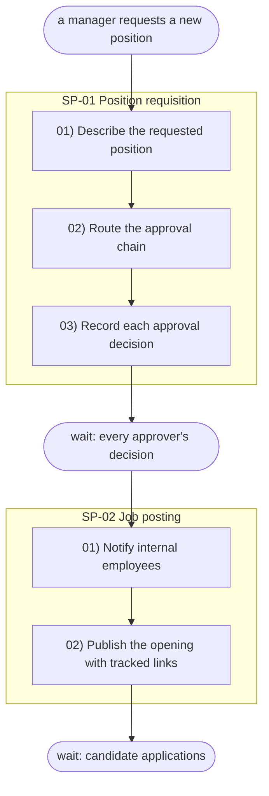

# Sample output — opscale-process

Reference example — a **recruitment** module (candidate lifecycle inside an
approved position requisition). The same example is used across the Plan
skills so the lists chain: every step here appears in
`docs/plan/bpmn.txt` with its operations, every logic id there has a
block in `sipoc.txt`, and every entity operated on exists in `dbml.txt`.

Shows the SHAPE of what the skill produces, not a full real module.

---

## Sample docs/plan/context/names.md

```markdown
# Names — Recruitment

| Canónico | ← alias |
|---|---|
| Requisition | position request, vacancy request, req |
| Candidate | applicant, prospect |
| Opening | job posting, publication, ad |
| Assessment | test, evaluation exam |
| Interview | round, meeting |
| Reference | work reference |
| Background check | verification, screening check |
| Offer | proposal, offer letter |
| Employee record | file, expediente |
```

## Sample docs/plan/process.txt

```
SP-01 Position requisition
Trigger: a manager requests a new position
Ends with: wait for every approver's decision
01) Describe the requested position
02) Route the approval chain
03) Record each approval decision

SP-02 Job posting
Trigger: the wait from Position requisition resolved (requisition approved)
Ends with: wait for candidate applications
01) Notify internal employees
02) Publish the opening with tracked links

SP-03 Application and screening
Trigger: candidate applications arrived
Ends with: wait for assessment results
01) Register each candidate with consent
02) Screen resumes against the approved profile
03) Send assessments to qualified candidates

SP-04 Interviews and verification
Trigger: assessment results arrived
Ends with: wait for references and background checks
01) Schedule each interview round
02) Record the standardized evaluation form
03) Advance or discard with documented reason
04) Request work references
05) Request background checks for sensitive positions

SP-05 Decision and offer
Trigger: references and background checks arrived
Ends with: wait for the candidate's response to the offer
01) Consolidate the comparative file
02) Record the committee decision
03) Send the offer
04) Escalate a counteroffer beyond the approved range

SP-06 Hiring and closure
Trigger: the candidate responded to the offer
Ends with: —
01) Record the signed acceptance
02) Handle a rejected offer
03) Open the employee record
04) Close the requisition as filled
05) Archive all candidate files
06) Send the welcome
```

## Sample docs/plan/process.mmd (excerpt — first two subprocesses)

Same flow as `process.txt`, as the self-contained flowchart. Node ids are the
parseable contract (`sXX_YY` = step SP-XX-YY, `spXX` = subprocess, `t0`/`wXX` =
trigger/waits); labels are free text in the user's language. Entity ids are NOT
assigned here — they are born in `opscale-dbml` on the final entities.


