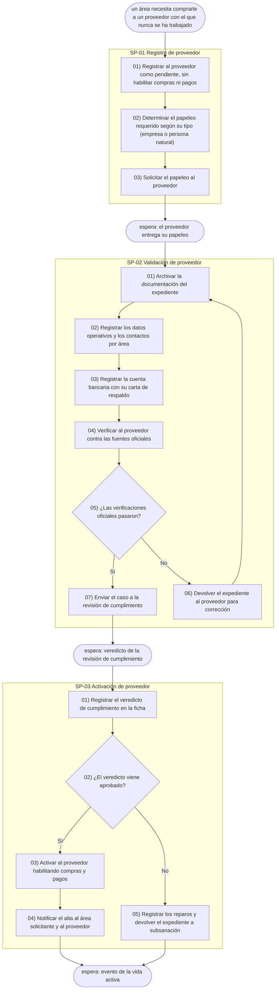

# Sample output — opscale-process

Reference example — the **Proveedores** module (supplier master lifecycle in
the Compras domain of `Dominio ERP`, project `compras/proveedores`). The same
real module is used across the Plan skills so the artifacts chain: every step
here appears in `docs/plan/bpmn.txt` with its operations, every logic id there
has a block in `sipoc.txt` and a file in `sipoc/`, every entity operated on
exists in `dbml.txt`, and `ontology.mmd` renders the whole hierarchy. The full
set passes every Plan validator.

The content is in **Spanish** on purpose: it demonstrates the language rule —
structural keywords (`Trigger:`, `Ends with:`) stay English (validators parse
them literally); step lines and entity names follow the user's language.

---

## Sample docs/plan/context/names.md

```markdown
# Names — Proveedores (Compras)

| Canónico | ← alias |
|---|---|
| Proveedor | proveedor, empresa nueva, persona que presta servicios por su cuenta, expediente, papeleo de fondo, registro del proveedor |
| Documento | escritura de constitución, identificación tributaria, acreditación de IVA, poder del representante, constancia de registro, documento de identidad, declaración fiscal, certificaciones, constancias, carta de confirmación de cuenta |
| Contacto | contacto técnico, contacto comercial, contacto administrativo |
| Cuenta bancaria | datos bancarios, banco, número y tipo de cuenta |
| Verificación oficial | consulta al fisco, confirmación en el registro, verificación del poder vigente |
| Revisión de cumplimiento | filtro de listas, dueño real (UBO), exposición política (PEP) — vive en el módulo kyc (Cumplimiento) |
| Vencimiento | calendario de vencimientos, fecha de caducidad, aviso de renovación |
| Observación de desempeño | notas sobre la marcha, apuntes de plazos, calidad, respuesta y facturación |
| Empleado | quien registra el alta, área solicitante, área usuaria, responsable del área — vive en el módulo expediente (RRHH) |
```

## Sample docs/plan/process.txt

Eight wait-bounded subprocesses covering the whole supplier lifecycle
(registro → validación → activación → vida activa → baja). Note the branch
lines (`… — Sí → 07 · No → 06`), the loop back (`retomar → 01`), and how
notifications stay internal steps while every boundary is a wait.

```
SP-01 Registro de proveedor
Trigger: un área de la empresa necesita comprarle a un proveedor con el que nunca se ha trabajado
Ends with: espera de que el proveedor entregue su papeleo
01) Registrar al proveedor como pendiente, sin habilitar compras ni pagos
02) Determinar el papeleo requerido según su tipo (empresa o persona natural)
03) Solicitar el papeleo al proveedor

SP-02 Validación de proveedor
Trigger: el papeleo del proveedor llegó
Ends with: espera del veredicto de la revisión de cumplimiento
01) Archivar la documentación del expediente
02) Registrar los datos operativos y los contactos por área
03) Registrar la cuenta bancaria con su carta de respaldo
04) Verificar al proveedor contra las fuentes oficiales
05) ¿Las verificaciones oficiales pasaron? — Sí → 07 · No → 06
06) Devolver el expediente al proveedor para corrección y retomar → 01
07) Enviar el caso a la revisión de cumplimiento

SP-03 Activación de proveedor
Trigger: el veredicto de la revisión de cumplimiento llegó
Ends with: espera de un evento de la vida activa
01) Registrar el veredicto de cumplimiento en la ficha
02) ¿El veredicto viene aprobado? — Sí → 03 · No → 05
03) Activar al proveedor habilitando compras y pagos
04) Notificar el alta al área solicitante y al proveedor
05) Registrar los reparos y devolver el expediente a subsanación

SP-04 Actualización de proveedor
Trigger: el calendario avisa de un vencimiento próximo, o llegó una solicitud de cambio o un documento de renovación
Ends with: espera del siguiente evento de la vida activa; si un documento crítico vence sin renovarse, resuelve hacia la suspensión
01) ¿Es un aviso de vencimiento? — Sí → 02 · No → 03
02) Avisar al proveedor que debe renovar el documento
03) Verificar el respaldo documental recibido
04) ¿Es un cambio de cuenta bancaria? — Sí → 05 · No → 06
05) Ejecutar la doble verificación del cambio de cuenta
06) Actualizar la ficha y recalcular vencimientos

SP-05 Evaluación de proveedor
Trigger: llegó el periodo de evaluación de rendimiento, o un área usuaria anota una observación de desempeño
Ends with: espera del siguiente evento de la vida activa
01) Registrar y clasificar la observación en la ficha del proveedor
02) ¿Revela un problema serio? — Sí → 03 · No → 04
03) Escalar el caso para evaluar la suspensión
04) Dejar la nota como insumo para renovaciones y decisiones futuras

SP-06 Suspensión de proveedor
Trigger: venció un documento crítico sin renovarse, o se confirmó un problema serio
Ends with: espera de que el proveedor regularice, o de que se decida la baja
01) Suspender al proveedor y registrar el motivo, bloqueando compras y pagos nuevos
02) Notificar la suspensión al proveedor y a las áreas usuarias

SP-07 Reactivación de proveedor
Trigger: el proveedor suspendido presenta su regularización
Ends with: espera del siguiente evento de la vida activa
01) Verificar el respaldo de la regularización
02) ¿La situación quedó regularizada? — Sí → 03 · No → 04
03) Reactivar al proveedor y notificar
04) Mantener la suspensión e informar lo que falta

SP-08 Baja de proveedor
Trigger: se decidió cerrar la relación, por la empresa, por el proveedor o por causa forzosa
Ends with: —
01) Registrar la baja, cerrar la ficha como inactiva y conservar el histórico
```

## Sample docs/plan/process.mmd (excerpt — first three subprocesses)

Same flow as `process.txt`, as the self-contained flowchart. Node ids are the
parseable contract (`sXX_YY` = step SP-XX-YY, `spXX` = subprocess, `t0`/`wXX` =
trigger/waits); labels are free text in the user's language. Branch steps use
the gateway shape and their edges carry the branch labels (`-- Sí -->`).
Entity ids are NOT assigned here — they are born in `opscale-dbml` on the
final entities.


